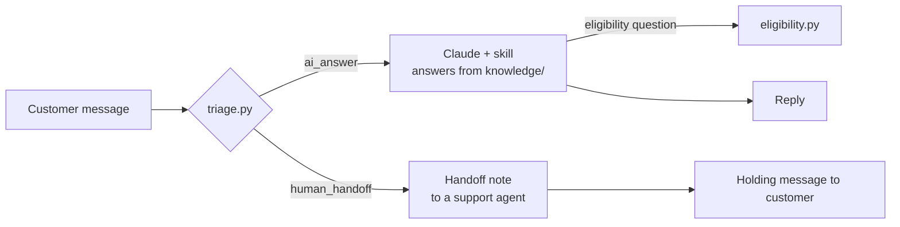

# flight-claims-support-agent

[](https://github.com/anton-yarmilko/flight-claims-support-agent/actions/workflows/ci.yml)

A first-line AI support agent for a **flight-compensation claims service** (EU261), built as a
Claude skill with a deterministic safety layer around it.

The idea: let AI answer the repetitive questions (am I eligible, what's the fee, where's my
claim, which documents) and send everything that needs judgment to a person - money, legal
threats, GDPR requests, upset customers, weak knowledge-base matches.

## What's inside

| Part | File | Role |
| --- | --- | --- |
| Claude skill | `skill/SKILL.md` | How the agent answers, hands off and writes notes |
| Knowledge base | `knowledge/*.md` | EU261 rules, fees, stages, documents |
| Triage | `claims_agent/triage.py` | Intent + AI-or-human decision with reasons |
| Eligibility | `claims_agent/eligibility.py` | EU261 coverage, 3-hour rule, distance bands |
| Evals | `evals/cases.jsonl` | Real-style messages with the expected intent and action |
| Tests | `tests/` | 26 tests, run in CI |



## Why a rules layer around the LLM

An LLM is good at writing a clear reply. It is not where the decision "may the bot answer this"
should live. Here that decision is plain Python: explicit, testable, and easy for a support lead
to change. Every handoff carries its reasons, so the team can see why the bot stepped back and
tune the rules from real tickets.

## Try it

```bash
pip install pytest
pytest -q

python -c "from claims_agent.triage import triage; print(triage('30% fee?! This is a scam!!!'))"
```

To use the skill in Claude Code, copy `skill/` into `~/.claude/skills/flight-claims-support/`
together with `knowledge/` and `claims_agent/`.

## Metrics I would track in production

Containment rate (resolved without a human) · handoff rate by reason · CSAT for AI vs human
replies · first response time · re-opened tickets after an AI answer · eval pass rate per release.

## Notice

Independent portfolio project. Fees and stages in `knowledge/fees-and-process.md` are a demo
configuration for a fictional service, and the EU261 summary is simplified - not legal advice.

Built by [Anton Yarmilko](https://www.linkedin.com/in/anton-yarmilko).
