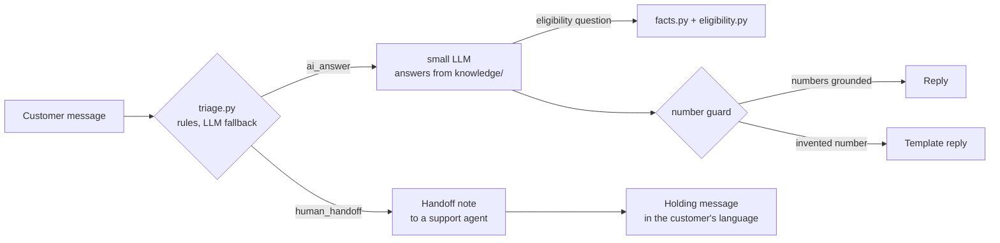
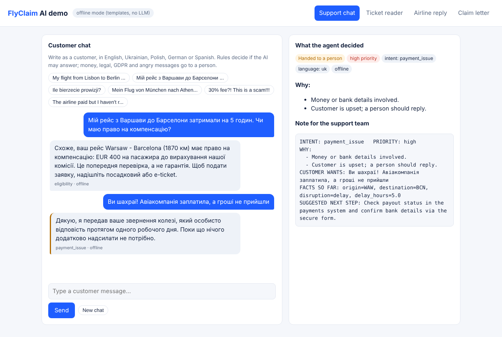

# flight-claims-support-agent

[](https://github.com/anton-yarmilko/flight-claims-support-agent/actions/workflows/ci.yml)

A first-line AI support agent for a **flight-compensation claims service** (EU261), with a
deterministic safety layer around a small, swappable LLM, and a web demo.

The idea: let AI answer the repetitive questions (am I eligible, what's the fee, where's my
claim, which documents) and send everything that needs judgment to a person - money, legal
threats, GDPR requests, upset customers, weak knowledge-base matches.

## What's inside

| Part | File | Role |
| --- | --- | --- |
| Web demo | `app/server.py`, `app/static/index.html` | Chat, ticket reader, airline-reply analysis, claim letter |
| Chat agent | `claims_agent/agent.py` | Triage, then an LLM reply from the knowledge base or a handoff note |
| LLM client | `claims_agent/llm.py` | Any OpenAI-compatible model (Groq, OpenRouter, Gemini, Ollama, OpenAI); offline without one |
| Triage | `claims_agent/triage.py` | Intent + AI-or-human decision, EN/UK/PL/DE/ES keywords, LLM only as a fallback |
| Eligibility | `claims_agent/eligibility.py`, `facts.py`, `airports.py` | EU261 check on facts pulled from the conversation |
| Ticket reader | `claims_agent/ticket.py` | Boarding-pass barcode text, e-ticket text, or a photo via a vision model |
| Airline reply | `claims_agent/airline_reply.py` | Names the refusal cause, maps it to EU case law, suggests contest / review |
| Claim letter | `claims_agent/claim_letter.py` | EU261 demand letter; amounts come from the check, never from the model |
| Claude skill | `skill/SKILL.md` | The same rules as a skill for Claude Code |
| Knowledge base | `knowledge/*.md` | EU261 rules, fees, stages, documents |
| Evals | `evals/cases.jsonl`, `evals/judge.py` | Triage cases in 5 languages; reply checks + optional LLM-as-judge |
| Tests | `tests/` | 72 tests, run in CI with a fake LLM server |



## Run the demo

```bash
python -m app.server                    # offline: rules + templates, no key needed
# open http://localhost:8000
```

With a small model (a free Groq key is enough):

```bash
export LLM_PROVIDER=groq LLM_API_KEY=gsk_...      # llama-3.1-8b-instant, vision: llama-4-scout
python -m app.server
```

Other options: `LLM_PROVIDER=ollama` (local `llama3.2:3b`, no key), `openrouter`, `gemini`,
`openai`, or `custom` with `LLM_BASE_URL` and `LLM_MODEL`. `LLM_MODEL` and `LLM_VISION_MODEL`
override the defaults. See `.env.example`.



The four tabs:

1. **Support chat** - write as a customer in English, Ukrainian, Polish, German or Spanish. The
   side panel shows the triage decision, the EU261 check and the handoff note.
2. **Ticket reader** - paste a booking email or the text under a boarding-pass barcode (parsed
   offline), or upload a photo (needs a vision model). Then check EU261 or draft the letter.
3. **Airline reply** - paste the airline's refusal; get the cause, the usual position in EU case
   law and the next step. A claims handler always decides.
4. **Claim letter** - a ready-to-review letter to the airline from the case facts.

## How the LLM is kept in its lane

- **Rules decide, the model writes.** Escalation to a person is plain Python. The LLM classifier is
  only asked when no rule matches, can only pick from a fixed intent list, and its confidence
  goes through the same 0.70 threshold. It can never turn an escalation into an AI answer.
- **Number guard.** A reply that quotes a number found neither in the knowledge base, the EU261
  check nor the customer's own message is thrown away and replaced by a template.
- **Typed extraction.** Ticket fields from the model are normalised and range-checked
  (airport codes, flight numbers, delay hours); implausible values are dropped and every field
  records whether it came from the barcode, the rules or the LLM.
- **Fixed recommendations.** For airline refusals the model may name the cause; the
  contest / review recommendation for each cause is written in code, with case-law references.
- **Works offline.** No key, a dead endpoint or bad JSON all fall back to the rule-based path.

## Why a rules layer around the LLM

An LLM is good at writing a clear reply. It is not where the decision "may the bot answer this"
should live. Here that decision is plain Python: explicit, testable, and easy for a support lead
to change. Every handoff carries its reasons, so the team can see why the bot stepped back and
tune the rules from real tickets.

## Tests and evals

```bash
pip install pytest
pytest -q                     # 72 tests, LLM calls go to a fake local server
python -m evals.judge         # reply checks on every eval case (offline: templates)

# with a model, plus a bigger judge model for LLM-as-judge scoring
LLM_PROVIDER=groq LLM_API_KEY=... JUDGE_MODEL=llama-3.3-70b-versatile python -m evals.judge --strict
```

`evals/judge.py` checks every reply for the right intent and action, the customer's language,
grounded numbers, no payout promises and no requests for card numbers. With a model configured
it also scores AI replies 1-5 for answering the question, grounding and tone.

To use the skill in Claude Code, copy `skill/` into `~/.claude/skills/flight-claims-support/`
together with `knowledge/` and `claims_agent/`.

## Metrics I would track in production

Containment rate (resolved without a human) · handoff rate by reason · CSAT for AI vs human
replies · first response time · re-opened tickets after an AI answer · eval pass rate per release ·
number-guard rejections per model · ticket fields corrected by staff after extraction.

## Notice

Independent portfolio project. The demo web server has no auth or rate limiting: run it
locally, not on the internet. Fees and stages in `knowledge/fees-and-process.md` are a demo
configuration for a fictional service, and the EU261 summary, airport table and case-law notes are simplified - not legal advice.

Built by [Anton Yarmilko](https://www.linkedin.com/in/anton-yarmilko).
