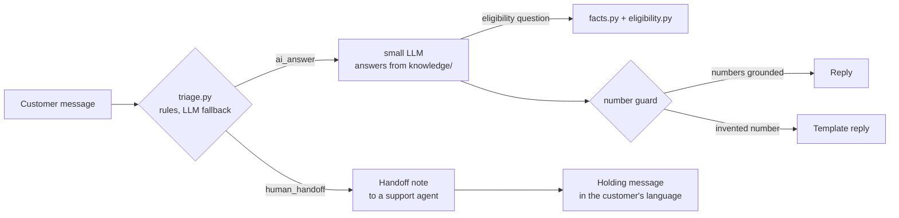
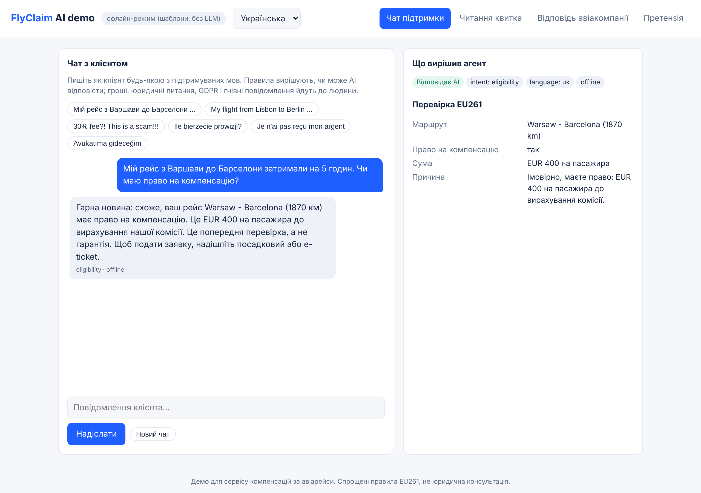

# flight-claims-support-agent

[](https://github.com/anton-yarmilko/flight-claims-support-agent/actions/workflows/ci.yml)

A first-line AI support agent for a **flight-compensation claims service** (EU261), with a
deterministic safety layer around a small, swappable LLM, and a web demo.

The idea: let AI answer the repetitive questions (am I eligible, what's the fee, where's my
claim, which documents) and send everything that needs judgment to a person - money, legal
threats, GDPR requests, upset customers, weak knowledge-base matches.

## What's inside

| Part | File | Role |
| --- | --- | --- |
| Web demo | `app/server.py`, `app/static/index.html` | Chat, ticket reader, airline-reply analysis, claim letter |
| Chat agent | `claims_agent/agent.py` | Triage, then an LLM reply from the knowledge base or a handoff note |
| LLM client | `claims_agent/llm.py` | Any OpenAI-compatible model (Groq, OpenRouter, Gemini, Ollama, OpenAI); offline without one |
| Triage | `claims_agent/triage.py` | Intent + AI-or-human decision, keywords in all 20 languages, LLM only as a fallback |
| Eligibility | `claims_agent/eligibility.py`, `facts.py`, `airports.py` | EU261 check on facts pulled from the conversation, incl. the 50% rule for long-haul delays of 3-4 h and the Article 7(2) halving when a cancelled or denied passenger was re-routed and arrived within 2/3/4 h. Connecting flights ("Warsaw via Frankfurt to Lisbon", "через Франкфурт", "przez Frankfurt") use the distance from first departure to final destination. A passenger who gave up the seat voluntarily ("I volunteered", "добровільно", "freiwillig") is told that volunteers get the agreed benefits, not compensation. 105 airports with names in the 20 languages; accents optional ("Amsterdam" = "Ámsterdam"), spelled-out delays ("tres horas", "чотири години", "3 і пів години") understood. Party size ("we were three", "нас було троє", "family of 4") multiplies the amount in the reply, the claim letter and the Inbox total. A flight over 2 years old goes to a person, because claim deadlines differ by country; the claim letter is marked not ready and can be downloaded as .txt. "Yesterday" / "вчора" / "wczoraj" become a date; a future date asks for a past flight; the handoff note carries the EU261 numbers |
| Ticket reader | `claims_agent/ticket.py` | Boarding-pass barcode text, e-ticket text, or a photo via a vision model |
| Airline reply | `claims_agent/airline_reply.py` | Names the refusal cause, maps it to EU case law, suggests contest / review |
| Claim letter | `claims_agent/claim_letter.py` | EU261 demand letter; amounts come from the check, never from the model |
| Claude skill | `skill/SKILL.md` | The same rules as a skill for Claude Code |
| Knowledge base | `knowledge/*.md` | EU261 rules, fees, stages, documents |
| Evals | `evals/cases.jsonl`, `evals/judge.py` | Triage cases in all 20 languages; reply checks + optional LLM-as-judge |
| Inbox | `claims_agent/inbox.py` | Batch triage of a day of mail: AI share, handoff reasons, urgent cases, compensation found |
| Tests | `tests/` | 258 tests, run in CI with a fake LLM server |



## Run the demo

```bash
python -m app.server                    # offline: rules + templates, no key needed
# open http://localhost:8000
```

With a small model (a free Groq key is enough):

```bash
export LLM_PROVIDER=groq LLM_API_KEY=gsk_...      # gpt-oss-20b, vision: qwen3.8-27b
python -m app.server
```

Other options: `LLM_PROVIDER=ollama` (local `llama3.2:3b`, no key), `openrouter`, `gemini`,
`openai`, or `custom` with `LLM_BASE_URL` and `LLM_MODEL`. `LLM_MODEL` and `LLM_VISION_MODEL`
override the defaults. See `.env.example`.


## Languages

The demo covers the 20 languages on the airadvisor.com language switcher (23 entries; English
UK/US, French/Canadian French and German/Austrian German share one translation): English,
Spanish, German, French, Romanian, Portuguese, Polish, Serbian (Latin), Greek, Turkish, Hungarian,
Danish, Norwegian, Finnish, Dutch, Swedish, Czech, Italian, Ukrainian and Russian.

- The UI language is picked in the header (saved in the browser, defaults to the browser language).
  Strings live in `claims_agent/locales/<code>.json`; English fills any missing key.
- The chat answers in the language the customer writes in, detected offline
  (`claims_agent/language.py`), whatever the UI language is.
- The airline-reply analysis and the claim letter stay in English: they are for the claims team.



**Public demo:** https://flyclaim-ai-demo.vercel.app (offline mode, no LLM key, so replies come from
templates). `api/index.py` and `vercel.json` serve the same app as one Vercel Python function.

The six tabs:

1. **Support chat** - write as a customer in any of the 20 languages. The side panel shows the
   triage decision, the EU261 check and the handoff note.
2. **Inbox** - runs a day of customer mail (the 36 eval messages in 20 languages, or your own, one per
   line) through triage: share answered by AI, what goes to a person and why, urgent cases, eligible
   claims and the compensation they add up to. Rules only, so it is instant and free. Click a row to
   open it in the chat. **Download CSV** exports every row (language, topic, decision, route,
   amount, drafted reply) for the claims team; it opens directly in Excel.
   Filter chips show only what goes to a person, urgent cases or eligible claims.
3. **Ticket reader** - paste a booking email or the text under a boarding-pass barcode (parsed
   offline), or upload a photo (needs a vision model). Then check EU261 or draft the letter.
4. **Airline reply** - paste the airline's refusal; get the cause, the usual position in EU case
   law and the next step. A claims handler always decides. Thirteen causes are recognised, including
   sudden crew illness (C-156/22), runway debris (C-501/17), volcanic ash (C-12/11) and airport fuel
   failures (C-308/21).
5. **Claim letter** - a ready-to-review letter to the airline from the case facts. The letter and the handoff note have a Copy button.
6. **How it works** - the five steps (language, triage rules, facts and EU261 by code, the LLM
   writes, number guard) in plain words, for a non-technical audience.

The page works on phones (one-column layout, scrollable tab bar).

**Cost guard on the public demo:** LLM calls (chat, ticket, airline reply, letter) are capped per
visitor (first `X-Forwarded-For` hop) and in total over a sliding window: `LLM_RATE_PER_VISITOR`
(default 40), `LLM_RATE_TOTAL` (600) per `LLM_RATE_WINDOW_SECONDS` (600). Over the cap the request
still works with the offline templates and the reply shows `(rate limit)`. Inbox and the EU261
check never use the LLM.

**Input limits and headers:** a chat message is capped at 2,000 characters, a pasted ticket or airline
letter at 8,000, chat history at the last 12 user/assistant turns (other roles are dropped). The page is
served with a strict Content-Security-Policy, `X-Frame-Options: DENY` and `Referrer-Policy: no-referrer`.

**Monitoring:** `GET /api/health` returns `{"ok": true, ...}` with the LLM model and cache counts, for an
uptime checker. Every response carries a `Server-Timing` header, and each chat reply shows how long it took. The rule path (triage, fact extraction, EU261 check) takes about 0.6 ms per message, because all airport and phrase patterns are compiled once; `tests/test_speed.py` guards this.

The LLM client also keeps a small in-memory cache (256 answers, `LLM(cache_size=...)`): the same request
(for example a sample button pressed twice) is answered instantly and costs no tokens.

## How the LLM is kept in its lane

- **Rules decide, the model writes.** Escalation to a person is plain Python. The LLM classifier is
  only asked when no rule matches, can only pick from a fixed intent list, and its confidence
  goes through the same 0.70 threshold. It can never turn an escalation into an AI answer.
- **Number guard.** A reply that quotes a number found neither in the knowledge base, the EU261
  check nor the customer's own message is thrown away and replaced by a template.
- **Typed extraction.** Ticket fields from the model are normalised and range-checked
  (airport codes, flight numbers, delay hours); implausible values are dropped and every field
  records whether it came from the barcode, the rules or the LLM.
- **Fixed recommendations.** For airline refusals the model may name the cause; the
  contest / review recommendation for each cause is written in code, with case-law references.
- **Works offline.** No key, a dead endpoint or bad JSON all fall back to the rule-based path.

## Why a rules layer around the LLM

An LLM is good at writing a clear reply. It is not where the decision "may the bot answer this"
should live. Here that decision is plain Python: explicit, testable, and easy for a support lead
to change. Every handoff carries its reasons, so the team can see why the bot stepped back and
tune the rules from real tickets.

## Tests and evals

```bash
pip install pytest
pytest -q                     # 258 tests, LLM calls go to a fake local server
python -m evals.judge         # reply checks on every eval case (offline: templates)

# with a model, plus a bigger judge model for LLM-as-judge scoring
LLM_PROVIDER=groq LLM_API_KEY=... JUDGE_MODEL=openai/gpt-oss-120b python -m evals.judge --strict
```

`evals/judge.py` checks every reply for the right intent and action, the customer's language,
grounded numbers, no payout promises and no requests for card numbers. With a model configured
it also scores AI replies 1-5 for answering the question, grounding and tone.

To use the skill in Claude Code, copy `skill/` into `~/.claude/skills/flight-claims-support/`
together with `knowledge/` and `claims_agent/`.

## Metrics I would track in production

Containment rate (resolved without a human) · handoff rate by reason · CSAT for AI vs human
replies · first response time · re-opened tickets after an AI answer · eval pass rate per release ·
number-guard rejections per model · ticket fields corrected by staff after extraction.

## Notice

Independent portfolio project. The demo web server has no auth or rate limiting: run it
locally, not on the internet. Fees and stages in `knowledge/fees-and-process.md` are a demo
configuration for a fictional service, and the EU261 summary, airport table and case-law notes are simplified - not legal advice.

Built by the repository owner.
